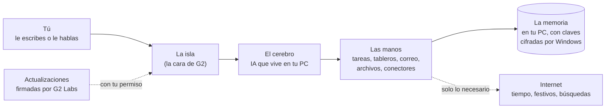

# G2 · tu asistente de escritorio

G2 vive en una pequeña isla arriba de tu pantalla. Le escribes como a una persona («recuérdame llamar a Martha mañana a las 9», «¿va a llover hoy?», «agrega al tablero revisar el contrato») y él se encarga: te avisa, te organiza y te ayuda a concentrarte. Todo lo que guarda se queda en **tu** computador.

Hecho por [G2 Labs](https://g2labs.co).

## Instalar

1. En la [última versión](../../releases/latest), descarga **`G2-Setup-<versión>.exe`**.
2. Ábrelo y sigue el asistente (Siguiente, Siguiente). No pide permisos de administrador.
3. Windows puede decir «editor desconocido»: toca **Más información › Ejecutar de todas formas**.

Si G2 ya estaba instalado, el asistente te deja **reparar** (instala todo de nuevo y conserva tus datos) o hacer una **instalación limpia**. Desde la versión 0.6.0, G2 **se actualiza solo**: te avisa cuando hay una versión nueva y la instala si le dices que sí.

## Qué hace

| | |
|---|---|
| **Tu día** | Tareas con recordatorio, hábitos con racha, bloques de enfoque, rutinas y un resumen de cómo vas. |
| **Tableros** | Al estilo de las notas adhesivas en columnas: «Por hacer», «Haciendo», «Hecho», con fechas límite y listas de chequeo. |
| **Mi día** | El tiempo de tu ciudad, el dólar, los festivos, tu agenda (enlace de tu calendario) y tus noticias. |
| **Correo** | Te avisa lo importante, te dice si **no** llegó el correo que esperabas, resume lo nuevo y deja respuestas listas como borrador. Nunca envía nada por ti. |
| **Tu PC** | Ordena el escritorio (sin borrar nunca), saca el texto de una captura, avisa cuando llega un archivo a Descargas, controla volumen y música. |
| **En tu celular** | Si quieres, te manda los avisos por Telegram y le puedes escribir desde allá. |
| **Conectores** | Se conecta con otras herramientas por MCP, el estándar abierto que usan los asistentes modernos. |

## Cómo está construido (sin tecnicismos)

Piensa en G2 como una pequeña oficina que trabaja dentro de tu PC:



- **La isla** es una ventana hecha con Electron, la misma tecnología de programas como Visual Studio Code o Slack. Se pega a cualquier borde de la pantalla y tiene expresiones: se alegra, se concentra, toma café y se duerme si no la usas.
- **El cerebro** es una IA que corre en tu computador (el motor abierto llama.cpp con un modelo Qwen 3). Lo que le escribes **no sale a internet**. La IA solo decide *qué* acción hacer; las reglas de G2 se encargan de *cómo*, y para todo lo delicado G2 te pregunta antes.
- **Las manos** son módulos: el correo se conecta directo de tu PC a tu proveedor (sin pasar por G2 Labs), el lector de texto es el que ya trae Windows y los conectores usan un estándar abierto (MCP).
- **La memoria** queda en tu computador. Las contraseñas (correo, Telegram) se guardan cifradas con la protección de tu cuenta de Windows.
- **Lo que sale a internet** es solo lo que pides: el nombre de tu ciudad para el tiempo, la fecha para los festivos, lo que buscas. Nunca tus tareas, tus correos ni tus datos.

## Por qué puedes confiar en las actualizaciones

Cada versión va **firmada** por G2 Labs, como un sello notarial digital (firma Ed25519). Antes de instalar algo, G2 comprueba tres cosas: que el sello sea auténtico, que la versión sea más nueva que la tuya y que el archivo descargado sea exactamente el que se firmó (su huella SHA-256). Si algo no cuadra, no instala nada.

Para verificar tú mismo una descarga, en PowerShell:

```powershell
Get-FileHash .\G2-Setup-0.6.0.exe -Algorithm SHA256
```

y compara el resultado con la huella que aparece en las notas de esa versión.

---

Este repositorio solo publica los instaladores. El código de G2 es privado.
